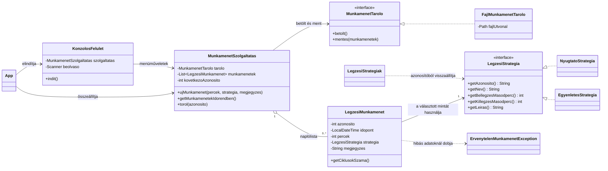

# UML és tervezési döntések

## Osztálydiagram

## A Strategy minta szerepe

A két légzési mód eltérő belégzési és kilégzési időt ad. A
LegzesiStrategia interfész meghatározza az adatokat és műveleteket, amelyeket
minden minta biztosít. A NyugtatoStrategia és az EgyenletesStrategia ezt az
interfészt valósítja meg. A LegzesiMunkamenet a stratégia interfészen át kéri le
az időket, amikor kiszámolja a teljes ciklusokat.

Így az eltérő viselkedés futás közben, a kiválasztott stratégia objektumától
függ. Egy új minta hozzáadásához új LegzesiStrategia-megvalósítás készíthető; a
munkamenet ciklusszámítását nem kell módosítani.

## Fő tervezési döntések

- A konzolos felület egy beolvasó osztályban marad, az adatkezelés pedig a
  szolgáltatásban. Így a felhasználói menü nem ír közvetlenül fájlt.
- A mentés UTF-8 kódolású, tabulátorral elválasztott szövegfájl. A mezők
  sorrendje: azonosító, időpont, perc, mintaazonosító, megjegyzés.
- A naplófájlt nem kell előre létrehozni. Az első mentés létrehozza az
  adatok mappát és a fájlt.
- A minták azonosítója stabil szöveg, így a fájlban tárolt rekordok a
  program újraindítása után is visszaállíthatók.
- Hiba esetén a szolgáltatás visszaállítja a memóriabeli listát, ha a fájlba
  mentés nem sikerült.

## Korlátok

- Egyetlen, helyi fájlt használ; többfelhasználós vagy hálózati működés nincs.
- Hibás fájlsor esetén a betöltés hibával leáll, és jelzi a sor számát. A fájlt
  kézzel kell kijavítani.
- A ciklusszám csak matematikai becslés a megadott idő és kiválasztott minta
  alapján. A program nem méri, hogy a gyakorlat valóban megtörtént-e.

